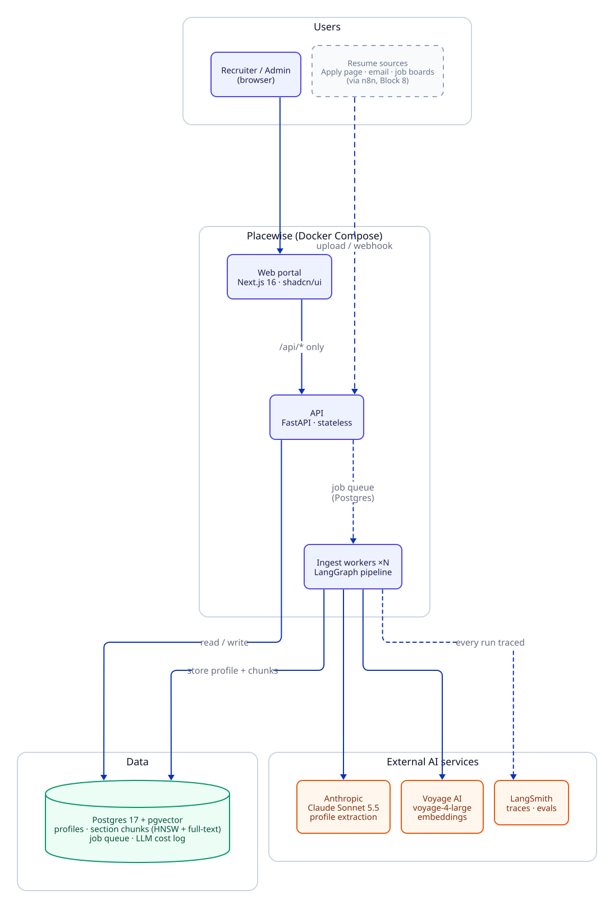
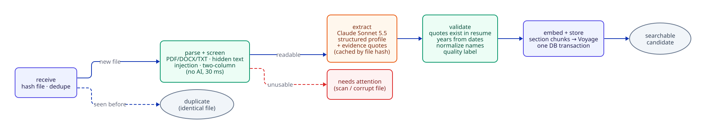

# Placewise

An AI layer for A/E/C (Architecture, Engineering & Construction) recruiting. It turns resumes and messy job notes into evidence-backed shortlists, submittals and outreach. It sits on top of your ATS and doesn't replace it.

> 🚧 Work in progress. See [`docs/PLAN.md`](docs/PLAN.md) for build status and [`docs/PROJECT_BRIEF.md`](docs/PROJECT_BRIEF.md) for scope.

**Stack:** Next.js · FastAPI · LangChain · LangGraph · LangSmith · Claude · Voyage AI · Postgres + pgvector · n8n · Docker Compose

## Current status: Block 2 (Ingest pipeline)
- **Block 0 (Foundation):** three containers start with one command and a **System status** page shows whether the API, the database (with pgvector) and LangSmith are connected. Details: [`docs/modules/foundation.md`](docs/modules/foundation.md).
- **Block 1 (Synthetic data):** a fully fake A/E/C candidate pool with a known answer key: **597 resumes** (349 PDF, 190 DOCX, 58 TXT, including image-only, corrupt, hidden-injection and duplicate files), **15 job orders** with messy recruiter notes, and a relevance key. Details: [`docs/modules/synthetic-data.md`](docs/modules/synthetic-data.md).
- **Block 2 (Ingest pipeline):** resumes become searchable candidates. A LangGraph pipeline per resume: dedupe by file hash → parse and screen without AI (hidden text, prompt injection, two-column PDFs, scans) → **Claude Sonnet 5.5** structured extraction (cached, spend-capped) → **code validation** (credential quotes must exist in the resume, years computed from dates) → section chunks embedded with **Voyage** and stored in one transaction. Workers pull jobs from a Postgres `SKIP LOCKED` queue with retries, backoff and crash recovery. On all 597 seed resumes: routing 597/597, licenses+state 99.7%, years MAE 0.04, 563 = 563 people, about $12 total. Details: [`docs/modules/ingest.md`](docs/modules/ingest.md).

There is no recruiter UI for candidates yet: the portal shell and login come in Block 3. Today the candidates are available through the API.

## Quick start
Needs only Docker Desktop and git. Everything (db included) runs in containers.

```bash
cp .env.example .env
# Fill in .env:
#   APP_SECRET_KEY     → openssl rand -hex 32
#   POSTGRES_PASSWORD  → openssl rand -hex 24   (URL-safe characters only)
#   PLACEWISE_LANGSMITH_TEST_API_KEY
#   PLACEWISE_ANTHROPIC_TEST_API_KEY (seed data + ingest extraction)
#   PLACEWISE_VOYAGE_TEST_API_KEY    (ingest embeddings)
docker compose up --build             # add  --scale worker=3  for faster ingest
```

Open **http://localhost:3000**. It goes to the dashboard if you're signed in, otherwise to the login page
(demo users `admin` and `recruiter`, passwords in `.env`). Admin → **System status** should show "All systems operational".

| URL | What |
|---|---|
| http://localhost:3000 | Web portal (redirects to the dashboard or the login page) |
| http://localhost:3000/admin/system | System status: API, database and LangSmith health (admin) |
| http://localhost:3000/admin/test-data | Test data: synthetic data progress, stats, sample resumes (admin; the dev endpoints exist only when `APP_ENV=dev`; `/seed` redirects here) |
| http://localhost:8000/docs | API docs (only when `APP_ENV=dev`, local only) |
| http://localhost:8000/api/candidates | Candidates API (requires a signed-in session; local only) |

All ports bind to `127.0.0.1`. The database isn't published to the host.

## Public demo link (Cloudflare quick tunnel)
Same features as local, reachable over HTTPS without a domain:
```bash
docker compose -f docker-compose.yml -f docker-compose.public.yml up -d --build
docker compose -f docker-compose.yml -f docker-compose.public.yml logs tunnel | grep trycloudflare
```
- The web app runs as a production build; cookies are HTTPS-only; the login rate limit uses Cloudflare's client IP.
- Everything works as it does locally, except **Reset ingested data**, which is disabled so the shared demo can't be wiped.
- The daily AI spend cap is `PUBLIC_DAILY_LLM_SPEND_CAP_USD` (default $30).
- The address is random and changes when the tunnel restarts; the Mac must stay on and awake.
- Back to local development: `docker compose up -d --build` (dev server with hot reload).
- **Stable address:** a Cloudflare Worker (`infra/worker/`) at **https://placewise.bprakashputta.workers.dev** forwards to the tunnel, so the link stays the same when the tunnel's random address changes. `scripts/public-link.sh` starts the stack and re-points the Worker (needs `CLOUDFLARE_API_TOKEN` in `.env`, a token scoped to editing Workers).
- **Logs and observability:** Workers Logs are on (every request kept). In the Cloudflare dashboard: Workers & Pages → placewise → **Logs** (one JSON line per request: method, path, status, ms, country; never cookies, query values or bodies) and **Metrics**. App-side traces are in LangSmith; container logs via `docker compose logs api web worker tunnel`.

## Synthetic data (seed CLI)
Runs in the on-demand `seed` tools container. `write`, `samples` and `job-orders` call Claude Haiku 5.5 and need `PLACEWISE_ANTHROPIC_TEST_API_KEY` (a full run costs under $1).

```bash
docker compose run --rm seed facts --count 500 --seed 42   # candidate facts (ground truth), no LLM
docker compose run --rm seed samples                       # one PDF per template → outputs/samples/
docker compose run --rm seed write                         # LLM writes + fact-checks resumes (--limit, --ids, --force)
docker compose run --rm seed render                        # code noise + PDF/DOCX/TXT files
docker compose run --rm seed job-orders                    # job orders, targeted candidates, notes, answer key
docker compose run --rm seed write && docker compose run --rm seed render   # the targeted candidates' resumes
```
The answer key in `data/seed/truth/` is mounted only into the `seed` container, never into the api.

## Ingest resumes
```bash
curl -X POST 'http://localhost:8000/api/dev/ingest/seed'            # queue all 597 seed resumes (dev only; ?limit=10 for a sample)
curl http://localhost:8000/api/ingest/summary                       # job counts by status
curl -F file=@my_resume.pdf http://localhost:8000/api/candidates/upload   # PDF/DOCX/TXT, max 10 MB
curl -X POST http://localhost:8000/api/ingest/jobs/retry-failed     # requeue failed jobs
docker compose logs -f worker                                       # one line per job
```
A full seed ingest costs about $12 in Claude calls. A daily spend cap (`DAILY_LLM_SPEND_CAP_USD`, default $10) pauses jobs when reached. `POST /api/dev/ingest/reset?confirm=yes` clears ingested data but keeps the extraction cache, so a re-ingest costs no LLM spend.

## Candidates API
| Endpoint | What |
|---|---|
| `GET /api/candidates?q=&discipline=&metro=&license=PE:TX&min_years=&quality=` | Current candidates with filters |
| `GET /api/candidates/facets` | Counts for filter dropdowns |
| `GET /api/candidates/needs-attention` | Files that couldn't be read, with the reason |
| `GET /api/candidates/{person_id}` | Profile, findings, validation notes, versions |
| `GET /api/candidates/files/{id}` · `/files/{id}/view` | Download the original · inline PDF view |
| `POST /api/candidates/upload` | Upload a resume |

Full list, including ingest job endpoints: [`docs/modules/ingest.md#apis`](docs/modules/ingest.md#apis). Auth is added in Block 3.

## Run the tests
Unit tests (no database, network or model calls; the same command CI runs):
```bash
docker build -f docker/api.Dockerfile -t placewise-api:ci .
docker run --rm -v "$PWD/tests:/app/tests:ro" -v "$PWD/prompts:/app/prompts:ro" \
  placewise-api:ci pytest -q -p no:cacheprovider /app/tests
```
246 unit tests. DB integration tests (24: migrations, queue concurrency, the store transaction) run only against a **throwaway** database:
```bash
docker compose exec -T db psql -U placewise -d placewise -c "CREATE DATABASE placewise_qa"
docker run --rm --network placewise_default -v "$PWD/tests:/app/tests:ro" -v "$PWD/prompts:/app/prompts:ro" \
  -e PLACEWISE_TEST_DATABASE_URL="postgresql://placewise:$(grep ^POSTGRES_PASSWORD= .env | cut -d= -f2-)@db:5432/placewise_qa" \
  placewise-api:ci pytest -q -p no:cacheprovider /app/tests/test_ingest_db_integration.py
docker compose exec -T db psql -U placewise -d placewise -c "DROP DATABASE placewise_qa"
```

## Evals
Run in the `seed` container (the only one that can read the answer key):
```bash
docker compose run --rm --entrypoint python seed -m placewise.evals.parse_screen      # parsing + screening, no AI
docker compose run --rm --entrypoint python seed -m placewise.evals.extract --model claude-sonnet-5-5 --limit 20   # paid
docker compose run --rm --entrypoint python seed -m placewise.evals.ingest_db         # stored data vs answer key
```
Results are in [`docs/modules/ingest.md#evals`](docs/modules/ingest.md#evals).

## CI and pull requests
Each block is merged through a GitHub pull request. On every PR:
- [`ci.yml`](.github/workflows/ci.yml) runs the unit tests in the api image, plus the web lint and build;
- [`claude-review.yml`](.github/workflows/claude-review.yml) posts an automated Claude Code review;
- mention `@claude` in a PR comment for follow-ups ([`claude.yml`](.github/workflows/claude.yml)).

Setup needed once (owner): add the `ANTHROPIC_API_KEY` repository secret and install the Claude GitHub App on the repo. Until then the two Claude workflows can't run.

## Docs
Diagrams (D2 sources in [`docs/diagrams/src/`](docs/diagrams/src/)):





- [Architecture](docs/diagrams/architecture.md) · [Deployment](docs/diagrams/deployment.md) · [Ingest graph](docs/diagrams/ingest-graph.svg) · [Queue lifecycle](docs/diagrams/queue-lifecycle.svg) · [Data model](docs/diagrams/data-model.svg) · [Health-check sequence](docs/diagrams/sequence-health-check.md) · [Seed pipeline sequence](docs/diagrams/sequence-seed-pipeline.md)
- Modules: [Foundation](docs/modules/foundation.md) · [Synthetic data](docs/modules/synthetic-data.md) · [Ingest](docs/modules/ingest.md)
- [Decisions (ADRs)](docs/decisions/)
- [Build log](docs/build-log.md): real problems hit and how they were fixed

**For agents/contributors:** start with [`AGENTS.md`](AGENTS.md).
