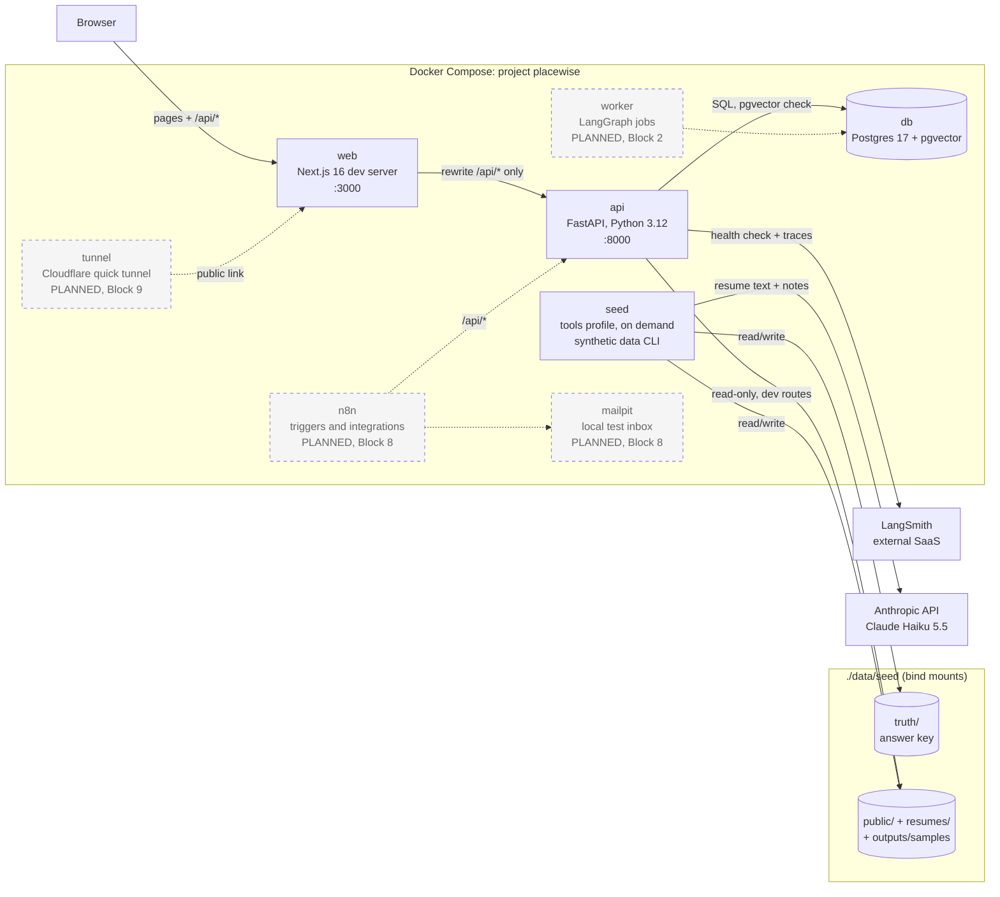

# Architecture

Containers and data flow. **Solid boxes are built (Blocks 0–1). Dashed boxes marked "PLANNED" do not exist yet.**

## What exists now
| Container | Role |
|---|---|
| `web` | The only thing the browser talks to. Proxies **only** `/api/*` to the api ([ADR 003](../decisions/003-web-proxies-only-api.md)). Pages: System status (`/`) and the dev-only Seed page (`/seed`). |
| `api` | Stateless FastAPI. `/api/health` (readiness), `/livez` (liveness), dev-only `/docs`, `/dev/trace` and `/api/dev/seed/*`. Mounts `data/seed/public`, `data/seed/resumes` and `outputs/samples` **read-only**; `data/seed/truth` is **not mounted** ([ADR 008](../decisions/008-answer-key-isolation.md)). |
| `seed` | On-demand tools container (`profiles: ["tools"]`, `docker compose run --rm seed …`), same image as the api. Generates facts, calls Claude Haiku 5.5 to write resumes and job-order notes, renders files and builds the answer key. The only container that mounts `data/seed/truth` (it mounts all of `./data`). LangSmith tracing is off. See [Synthetic data](../modules/synthetic-data.md). |
| `db` | The single data store ([ADR 001](../decisions/001-postgres-pgvector-single-store.md)). Not used by Block 1. |
| LangSmith | External tracing service; checked by `/api/health`. |
| Anthropic API | External; used only by `seed` so far. |

## Mounts for seed data
| Host path | `seed` | `api` |
|---|---|---|
| `./data` (includes `seed/truth`, `seed/generated`) | read/write | **not mounted** |
| `./data/seed/public` | read/write (via `./data`) | read-only |
| `./data/seed/resumes` | read/write (via `./data`) | read-only |
| `./outputs` (`outputs/samples`) | read/write | `outputs/samples` read-only |
| `./prompts` | read-only | not mounted |

## Planned (not built)
- **worker** (Block 2): runs LangGraph jobs from a Postgres `SKIP LOCKED` queue.
- **n8n**, **mailpit** (Block 8): intake triggers, notifications, approved-outreach sending to a local inbox.
- **tunnel** (Block 9, optional): temporary public link to `web` only.
- **Evals** (Block 9) will be the only other reader of `data/seed/truth`.

See also: [deployment](deployment.md) · [health-check sequence](sequence-health-check.md) · [seed pipeline sequence](sequence-seed-pipeline.md) · [Foundation module](../modules/foundation.md) · [Synthetic data module](../modules/synthetic-data.md)
