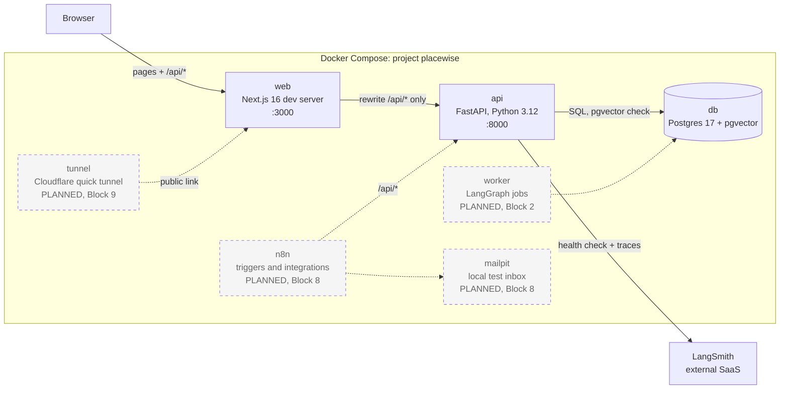

# Architecture

Containers and data flow. **Solid boxes are built (Block 0). Dashed boxes marked "PLANNED" do not exist yet.**

## What exists now (Block 0)
| Container | Role |
|---|---|
| `web` | The only thing the browser talks to. Proxies **only** `/api/*` to the api ([ADR 003](../decisions/003-web-proxies-only-api.md)). |
| `api` | Stateless FastAPI. `/api/health` (readiness), `/livez` (liveness), dev-only `/docs` and `/dev/trace`. |
| `db` | The single data store ([ADR 001](../decisions/001-postgres-pgvector-single-store.md)). |
| LangSmith | External tracing service; checked by `/api/health`. |

## Planned (not built)
- **worker** (Block 2): runs LangGraph jobs from a Postgres `SKIP LOCKED` queue.
- **n8n**, **mailpit** (Block 8): intake triggers, notifications, approved-outreach sending to a local inbox.
- **tunnel** (Block 9, optional): temporary public link to `web` only.

See also: [deployment](deployment.md) · [health-check sequence](sequence-health-check.md) · [Foundation module](../modules/foundation.md)
