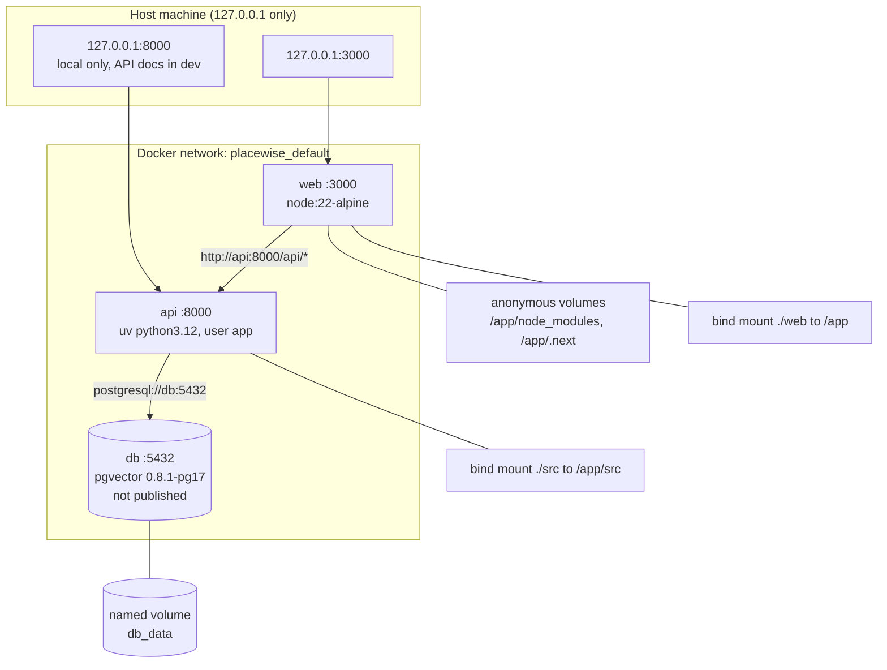

# Deployment (Docker Compose)

Everything runs in containers on one machine ([ADR 002](../decisions/002-everything-in-docker-compose.md)). Compose project name: `placewise`. No custom networks are defined, so all services share the default network `placewise_default` and reach each other by service name (`db`, `api`, `web`).

## Services
| Service | Container port | Host port | Volumes | Starts after | Healthcheck |
|---|---|---|---|---|---|
| `db` | 5432 | **none** (host Postgres owns 5432; optional `127.0.0.1:5433` for debugging) | `db_data` → `/var/lib/postgresql/data`; `./docker/db/init` → `/docker-entrypoint-initdb.d` (ro) | — | `pg_isready` every 5s |
| `api` | 8000 | `127.0.0.1:8000` | `./src` → `/app/src` (dev reload) | `db` healthy | `GET /livez` every 10s (image `HEALTHCHECK`) |
| `web` | 3000 | `127.0.0.1:3000` | `./web` → `/app`; anonymous `/app/node_modules`, `/app/.next` | `api` started | none |

All services use `restart: unless-stopped`.

## Notes
- The api's virtualenv lives in `/opt/venv`, outside `/app/src`, so mounting `./src` for reload doesn't hide installed packages.
- The anonymous volumes keep the image's `node_modules` and `.next` from being hidden by the `./web` bind mount. After changing web dependencies: `docker compose up --build -V web`.
- `WATCHPACK_POLLING=true` makes file watching reliable through Docker on macOS.

## What becomes public later
Today nothing is public: every published port binds to `127.0.0.1`.
When the optional **tunnel** is added (Block 9, **Planned**), it will expose **only `web`**. The api stays reachable only through web's `/api/*` proxy, and the db stays internal.

| Port | Now | Later (with tunnel) |
|---|---|---|
| web 3000 | localhost | **public via tunnel** |
| api 8000 | localhost (dev docs) | localhost only / internal |
| db 5432 | internal only | internal only |
