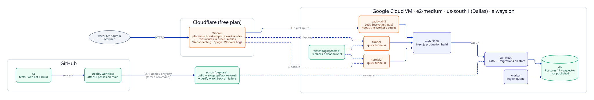

# Deployment (Docker Compose)

Everything runs in containers on one machine ([ADR 002](../decisions/002-everything-in-docker-compose.md)). Compose project name: `placewise`. No custom networks are defined, so all services share the default network `placewise_default` and reach each other by service name (`db`, `api`, `web`).

*Services, ports and volumes. Source: [`src/deployment.d2`](src/deployment.d2).*

## Services
| Service | Container port | Host port | Volumes | Starts after | Healthcheck |
|---|---|---|---|---|---|
| `db` | 5432 | **none** (host Postgres owns 5432; optional `127.0.0.1:5433` for debugging) | `db_data` → `/var/lib/postgresql/data`; `./docker/db/init` → `/docker-entrypoint-initdb.d` (ro) | — | `pg_isready` every 5s |
| `api` | 8000 | `127.0.0.1:8000` | `./src` → `/app/src` (dev reload); `storage` → `/app/storage`; read-only: `./prompts`, `./data/seed/public`, `./data/seed/resumes`, `./outputs/samples` (never `data/seed/truth`) | `db` healthy | `GET /livez` every 10s (image `HEALTHCHECK`) |
| `worker` | none (no HTTP) | none | `./src`; `storage` → `/app/storage`; read-only: `./prompts`, `./data/seed/resumes` (never `data/seed/truth`) | `db` healthy | disabled (it serves no HTTP) |
| `seed` | — | none | `./src`, `./data` (incl. `seed/truth`), `./outputs`; `./prompts` read-only | on demand (`docker compose run --rm seed …`, profile `tools`) | n/a (one-shot) |
| `web` | 3000 | `127.0.0.1:3000` | `./web` → `/app`; anonymous `/app/node_modules`, `/app/.next` | `api` started | none |

All long-running services use `restart: unless-stopped`.

## Worker notes
- Same image as the api (`docker/api.Dockerfile`), started with `python -m placewise.worker`.
- Scale out with `docker compose up -d --scale worker=3`. Each process runs `WORKER_CONCURRENCY` jobs at once (default 4).
- `stop_grace_period: 60s`: on SIGTERM a worker stops claiming and finishes in-flight jobs. Anything cut off is reclaimed by another worker after 10 minutes.
- Both the api and the worker run migrations at startup; an advisory lock makes that safe when several start together.

## Notes
- The api's virtualenv lives in `/opt/venv`, outside `/app/src`, so mounting `./src` for reload doesn't hide installed packages.
- The image creates `/app/storage/uploads` owned by the non-root `app` user **before** the named volume is mounted, so a fresh `storage` volume inherits that ownership. (Uploads failed when it was root-owned; reviewer blocker fixed in `8fc541e`.)
- Prompts are copied into the image and also bind-mounted in dev. A changed bind mount needs a container **recreate** (`docker compose up -d`), not a restart.
- The anonymous volumes keep the image's `node_modules` and `.next` from being hidden by the `./web` bind mount. After changing web dependencies: `docker compose up --build -V web`.
- `WATCHPACK_POLLING=true` makes file watching reliable through Docker on macOS.

## Public demo (cloud server)
The public demo runs the **same Compose stack** on an always-on Google Cloud VM (`placewise-vm`, e2-medium, standard provisioning, `us-south1` Dallas), started with `docker-compose.yml` + `docker-compose.public.yml` + `docker-compose.server.yml`.

*Source: [`src/public-deployment.d2`](src/public-deployment.d2).*

| Piece | What it does |
|---|---|
| Cloudflare Worker (`infra/worker`) | The public address. Tries the direct route, then the two tunnels; retries routes that never reached the app (530/521–523/525/526), repeats a POST only then or after a fast connection failure; shows a self-reloading "Reconnecting…" page if everything is down. Workers Logs on. |
| `caddy` (`docker-compose.server.yml`) | Direct HTTPS route on `<ip>.sslip.io` (Let's Encrypt). Answers 404 unless the request carries the Worker's secret header; passes the visitor's IP to the api. |
| `tunnel`, `tunnel2` | Two Cloudflare quick tunnels (backup routes). |
| Watchdog (`scripts/watch-public-link.sh`, systemd) | Every 20 s checks each tunnel; replaces one only on 530 / no connection; pauses during deploys. |
| Deploy (`.github/workflows/deploy.yml` → `scripts/deploy.sh`) | After CI passes on `main`: build, swap api/worker/web, verify, roll back on failure ([ADR 020](../decisions/020-auto-deploy-main-to-cloud-server.md)). |
| Alerts | Google Cloud uptime check (email after 2 minutes down) and a $20 budget alert. |

What is reachable from the internet:

| Port | Local (Mac) | Cloud server |
|---|---|---|
| web 3000 | localhost | only through Caddy or the tunnels, both via the Worker |
| api 8000 | localhost (dev docs) | localhost only; public traffic reaches it only through web's `/api/*` proxy |
| db 5432 | internal only | internal only |
| 443 / 80 | — | Caddy (404 without the Worker's secret) |
