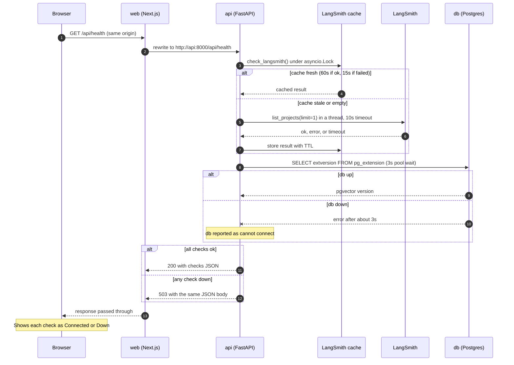

# Sequence: System status (health check)

What happens when the System status page loads or the user clicks **Recheck**. Code: `web/src/app/system-status.tsx`, `web/next.config.ts`, `src/placewise/main.py`, `src/placewise/health.py`.

## Key points
- **Cache:** the LangSmith call is slow and external, so it's cached (60s on success, 15s on failure, timeouts included). The lock means concurrent requests share one check instead of each starting a thread.
- **db-down path:** the pool waits at most 3s for a connection, then the check reports "cannot connect (<ExceptionType>)". The response is a 503 **with a body**, so the page still renders and marks Database as Down. QA measured recovery about 5s after restarting `db`.
- **api-down path (not shown):** the Next.js proxy returns a plain-text 500; the page can't parse it as JSON and shows "Can't reach the API. Is the api container running?"
- **Prod:** the same flow, but details are reduced to "connected"/"unavailable".
- **Not in this flow:** `/livez`, which Docker calls directly inside the api container and which checks nothing external.
