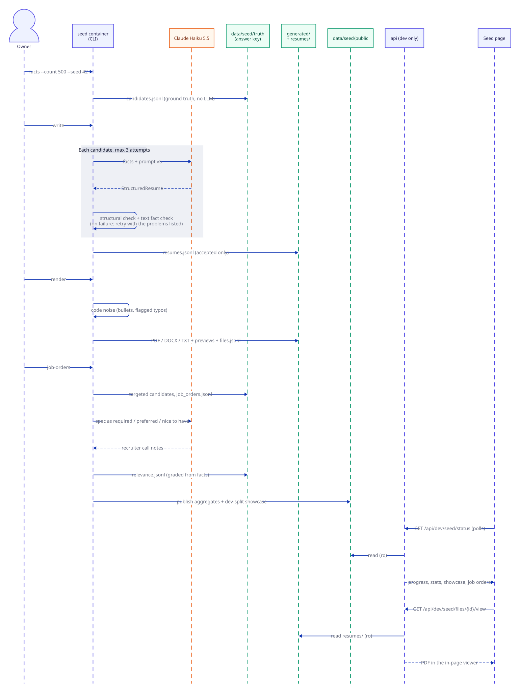

# Sequence: Synthetic data pipeline (Block 1)

How the seed CLI turns code-generated facts into resume files, job orders and an answer key, and how the dev-only Seed page shows the result. Code: `src/placewise/seed/` (`__main__.py`, `facts.py`, `writer.py`, `factcheck.py`, `noise.py`, `render.py`, `job_orders.py`, `public.py`), `src/placewise/dev_seed.py`, `web/src/app/seed/`.

*Seed pipeline sequence: facts, write with fact checks, render, job orders, publish, Seed page. Source: [`src/sequence-seed-pipeline.d2`](src/sequence-seed-pipeline.d2).*

## Key points
- **Truth first, text second.** Facts and the answer key come from code; the LLM only writes prose around them, and the checks make sure the text agrees ([ADR 006](../decisions/006-synthetic-data-code-facts-as-ground-truth.md)).
- **Structured output, then render.** The writer returns fields, not free text, so the renderer never guesses layout ([ADR 007](../decisions/007-structured-llm-output-plus-rendering.md)).
- **The api never sees `truth/`.** It reads only `public/` and `resumes/` (and `outputs/samples/`), read-only, and its seed routes exist only when `APP_ENV=dev` ([ADR 008](../decisions/008-answer-key-isolation.md)).
- After `job-orders`, run `write` and `render` again to produce the 97 targeted resumes (not shown).
- `publish` also runs at the end of `facts` and `render`; `write` updates `public/progress.json` live.

See also: [Synthetic data module](../modules/synthetic-data.md) · [architecture](architecture.md)
