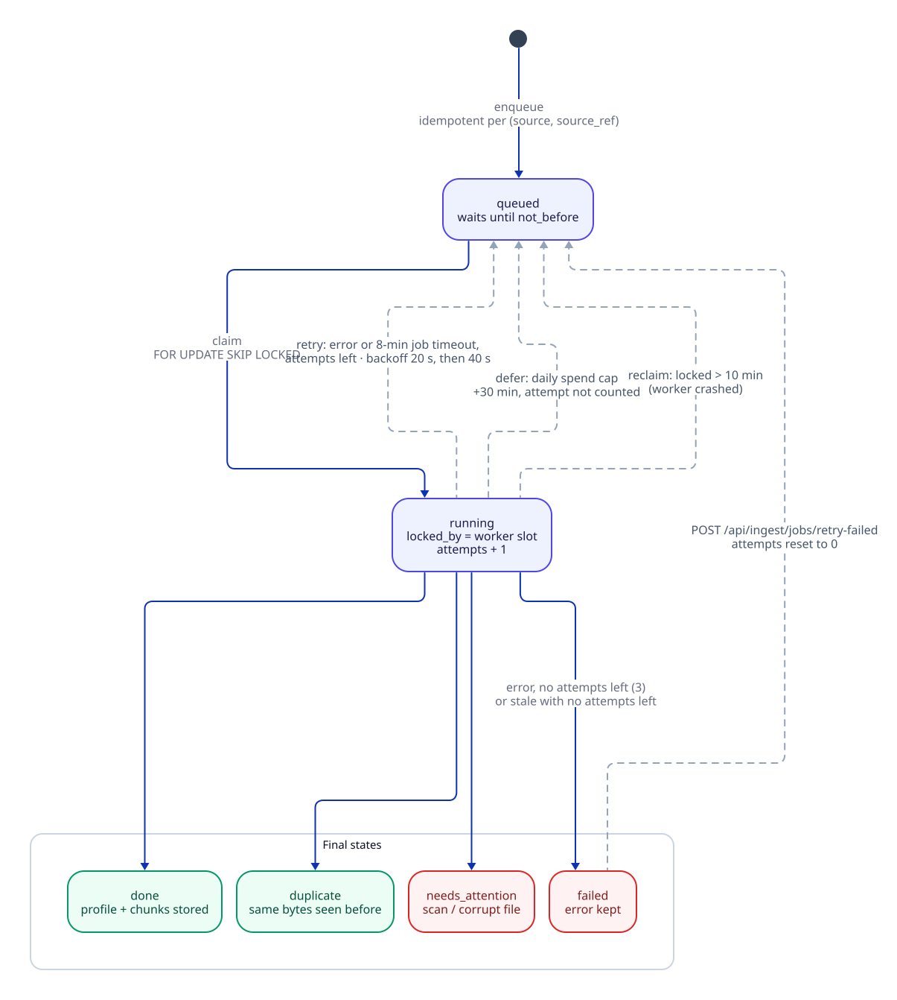
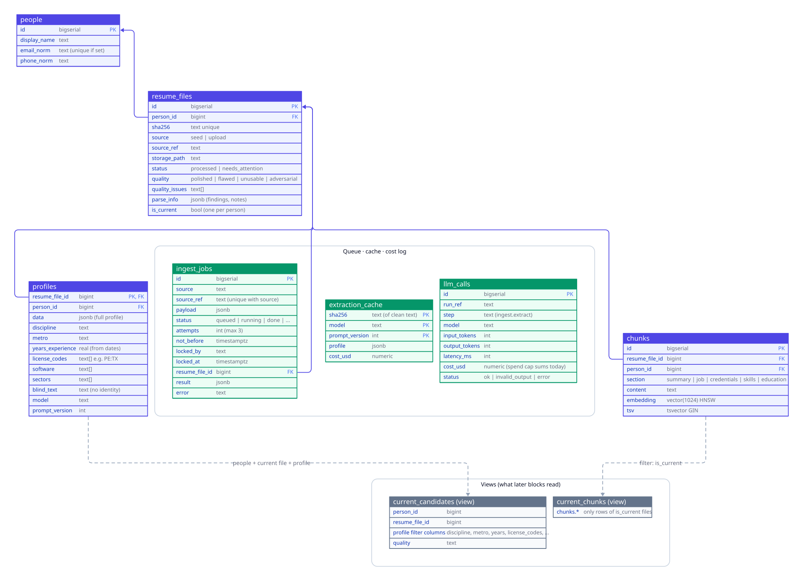

# Ingest pipeline (Block 2)

## Purpose (what a recruiter gets)
A recruiter drops in a resume (PDF, DOCX or TXT), and a minute later the candidate is **searchable**: name, discipline, location and metro, years of experience, licenses with their state (for example `PE:TX`), software, sectors, and every job split into its own searchable section. Resubmissions don't create duplicates: the same file is recognized, and a new version of the same person replaces the old one in search. Files that can't be read (scans, corrupt files) land in a **Needs attention** list with the reason, and resumes that try to manipulate an AI screener are flagged **adversarial**.

The pipeline never trusts the model for facts that code can check: credential quotes must appear in the resume, and years of experience are computed from the job dates.

Code: `src/placewise/ingest/` (`graph.py`, `parse.py`, `screen.py`, `extract.py`, `validate.py`, `chunk.py`, `store.py`, `queue.py`, `spend.py`, `sources.py`), `src/placewise/worker.py`, `src/placewise/migrate.py` + `migrations/`, `src/placewise/ingest_api.py`, `src/placewise/candidates_api.py`. Prompt: [`prompts/ingest_extract_profile.v1.yaml`](../../prompts/ingest_extract_profile.v1.yaml).

## The graph


*The LangGraph ingest graph. Green = plain code, orange = paid model call, red = needs attention. Source: [`diagrams/src/ingest-graph.d2`](../diagrams/src/ingest-graph.d2).*

Each resume is one LangGraph run and **one LangSmith trace** with a span per node ([ADR 011](../decisions/011-langgraph-ingest-pipeline.md)). Duplicates and unreadable files are routed away **before** any paid call. File bytes never enter the graph state; only the path and hash do, so traces stay small.

| Node | What it does | Paid? |
|---|---|---|
| `receive` | Reads the file, computes its SHA-256, sniffs the real type from the bytes. If the hash already exists in `resume_files`, routes to `duplicate`. If that existing row came from this same job (an earlier attempt committed but didn't finish), the outcome is `done`, not duplicate. | no |
| `parse_screen` | Turns the file into text without AI (`parse.py`), then screens it (`screen.py`). Routes `unusable` files to `store_unusable`. | no (~30 ms/file) |
| `extract` | Checks the extraction cache; on a miss, checks the daily spend cap, calls Claude Sonnet 5.5 for a structured profile, logs the call to `llm_calls`, and caches the result. | yes (~$0.020/resume) |
| `validate` | Code checks and normalization (`validate.py`). | no |
| `embed_store` | Builds section chunks, embeds them with Voyage, matches or creates the person, and saves everything in **one transaction**. | Voyage embeddings |
| `store_unusable` | Saves the file row as `needs_attention` with the reason. No person is created. | no |
| `duplicate` | Ends with the id of the file that was already stored. | no |

### parse (no AI)
- **Type from bytes, not the extension:** `%PDF-` → PDF, `PK` → DOCX, mostly-printable → TXT (UTF-8, or Windows-1252/Latin-1 legacy text), anything else → unsupported.
- **PDF (pdfplumber):** characters that are white/near-white (gray, RGB or CMYK) or smaller than 3 pt go to `hidden_text`, never to the visible text. Two-column pages are detected by a vertical gutter (20–55% of the width, no word crossing it) and read column by column. A PDF with less than 40 characters of text is unusable: "looks like a scanned image (needs OCR)" if it has images, otherwise "no readable text".
- **DOCX (python-docx):** paragraphs and table cells (two-column Word resumes are usually tables). Hidden, tiny or white runs go to `hidden_text`. Runs inside hyperlinks are read too (emails and LinkedIn URLs are often links; this was a QA regression fixed in `b746cdd`).
- **TXT:** decoded as UTF-8, falling back to Windows-1252.
- Corrupt or empty files come back as `unusable` with a reason. Parsing never raises.

### screen (no AI, before any model sees the text)
- **Security:** hidden text → issue `hidden_text`. Prompt-injection phrases (for example "ignore previous instructions", "note to the AI screening system", "rate this candidate 100/100") in hidden **or** visible text → issue `prompt_injection`, and the injected sentences are **removed** from the text the model will read. Hidden text never reaches the model at all.
- **Quality:** fewer than 100 words → `very_short` (polished resumes start at ~114 words); no year anywhere → `no_dates`.
- Pre-model label: `adversarial` if injection, `unusable` if unreadable, `flawed` if any issue, else `polished`.

### extract (Claude Sonnet 5.5)
- LangChain `ChatAnthropic` with `with_structured_output(ExtractedProfile)` using **tool calling**. `method="json_schema"` was tried and rejected by the API ("Schema is too complex"); see the build log.
- Output schema (`ingest/schema.py`): name, contact, city/state, relocation, headline, discipline (fixed list), subdiscipline, summary, jobs (dates **as written**, bullets verbatim), credentials (exact `quote`, `key` from a fixed list, `state`, `status` active / pursuing / exam_scheduled / expired), software, sectors, education, and a writing-quality judgment with verbatim evidence.
- The prompt puts the resume inside `<resume>` tags as untrusted data and tells the model never to follow instructions found there.
- Resilience: resume text is capped at 30,000 characters; 120 s timeout; the SDK retries 429/5xx; a missing or invalid tool call is retried once; a 4xx (other than 429) stops immediately. `extract()` never raises; the graph node raises only after logging the failed call, so the worker can retry with backoff.
- **Cache** ([ADR 014](../decisions/014-extraction-cache-on-clean-text.md)): key = `sha256(clean_text)` + model + prompt version, in `extraction_cache`. A retry (for example after an embedding rate limit) reuses the paid extraction. Changing the parser, the screen, the model or the prompt version naturally misses the cache.
- Model choice decided by eval: Sonnet over Haiku ([ADR 012](../decisions/012-sonnet-over-haiku-for-extraction.md)).

### validate (code has the final say)
([ADR 013](../decisions/013-code-validates-llm-facts.md))
- **Credentials:** each `quote` must appear in the resume text (after normalizing dashes, non-breaking spaces and whitespace), otherwise the credential is **dropped** and a note is kept. States only on state-issued licenses (PE, EIT, RA, SE, TX RID). `license_codes` keeps only **active** credentials, as `KEY:STATE` or `KEY` (pursuing, exam scheduled, expired and OTHER are excluded).
- **Years of experience:** computed from the job dates (many formats: `Jan 2019`, `01/2019`, `01/19`, `2019`, `Present`), overlapping jobs counted once, gaps not counted, rounded to half a year.
- **Normalization:** state names → two-letter codes; city + state → metro (from the shared A/E/C catalog, else "Other"); software and sectors → canonical names so SQL filters work.
- **Career gap:** 9+ months between jobs → `career_gap`.
- **Final quality:** `adversarial` beats everything, then `unusable`, then `flawed` (poorly written, typos unless the writing is rated good, unusual headings, career gap, very short, no dates), else `polished`. Hidden text alone is reported as an issue but doesn't make a resume flawed.

### embed_store
- **Chunks** (`chunk.py`): one per summary, per job, credentials, skills (software + sectors), and education. Each starts with the candidate's headline and discipline (`[Senior Civil Engineer | civil] job: …`) so a retrieved chunk makes sense on its own. **No name, email or phone** in chunks; the person is linked by id.
- **Embeddings:** Voyage `voyage-4-large`, 1024 dimensions, batches of 64.
- **blind_text:** a profile text without name, contact, location or graduation years, stored on `profiles` for unbiased scoring later (Block 6).
- **Person matching** ([ADR 015](../decisions/015-person-identity-email-or-phone-name.md)): same normalized email, **or** (only when there is no email) same phone AND same name. A phone alone never merges people. New people with an email are inserted with `ON CONFLICT (email_norm) DO UPDATE`, so two versions of one person processed at the same moment end up as one person.
- **Versions:** the new file becomes the person's `is_current` version, and the previous one is unset (a partial unique index allows one current file per person).
- **One transaction:** person, file row, profile and chunks are saved together or not at all. If another job stored the identical file meanwhile (`resume_files_sha256_key` violation), the outcome is `duplicate`.

## Queue and worker


*Lifecycle of an `ingest_jobs` row. Source: [`diagrams/src/queue-lifecycle.d2`](../diagrams/src/queue-lifecycle.d2).*

The queue is a Postgres table ([ADR 010](../decisions/010-postgres-job-queue-skip-locked.md)); the code is `ingest/queue.py` and `worker.py`.

| Concern | How it's handled |
|---|---|
| Idempotent enqueue | Unique `(source, source_ref)`; `INSERT … ON CONFLICT DO NOTHING`. Seed jobs use the candidate folder, uploads use the file's SHA-256, so re-submitting does nothing. |
| No double processing | `claim` = `UPDATE … WHERE id = (SELECT … FOR UPDATE SKIP LOCKED LIMIT 1)`, oldest first, only `queued` jobs whose `not_before` has passed. Sets `locked_by`, `locked_at`, `attempts + 1`. |
| Retries | On an error: back to `queued` with backoff `20 s × 2^(attempt−1)` (20 s, then 40 s). After `max_attempts` (3): `failed`, error and traceback kept. |
| Job timeout | `JOB_TIMEOUT_S` defaults to 8 minutes, below the 10-minute stale window, so a slow job is abandoned and retried before another worker could reclaim it. |
| Crashed worker | A reaper (one per worker process, every 60 s) requeues jobs `running` for more than 10 minutes. A job that already used all its attempts is marked `failed` ("possible crash on this file") instead of looping. |
| Lock ownership | `finish`, `fail` and `defer` only update the row if `locked_by` is still this worker slot. A late finisher after a reclaim can't overwrite the new owner's result. |
| Spend cap | `SpendCapReached` → `defer`: back to `queued` for 30 minutes **without** using an attempt. |
| Concurrency | `WORKER_CONCURRENCY` slots per process (default 4); the full ingest ran 3 workers × 4 slots. CPU-bound PDF parsing runs in a thread so it doesn't stall other slots. |
| Shutdown | SIGTERM stops claiming; in-flight jobs finish (60 s grace period); anything cut off is reclaimed later. |
| Migrations | `python -m placewise.migrate` (also run at api and worker startup): applies `migrations/NNN_*.sql` in order, each in a transaction, recorded in `schema_migrations`, under a Postgres advisory lock so concurrent starts don't collide. |
| Manual retry | `POST /api/ingest/jobs/retry-failed` puts failed jobs back with attempts reset. |

## Storage model


*Key columns only. `profiles.person_id` and `chunks.person_id` also reference `people`. Source: [`diagrams/src/data-model.d2`](../diagrams/src/data-model.d2).*

| Table / view | Holds | Migration |
|---|---|---|
| `people` | One row per person (`display_name`, normalized email (unique when set), normalized phone) | 001 |
| `resume_files` | Every file received: SHA-256 (unique), source, storage path, status (`processed` / `needs_attention`), detected quality and issues, parse findings and validation notes, `is_current` | 001 |
| `profiles` | The validated profile as JSONB plus filter columns (discipline, metro, years, `license_codes`, software, sectors with GIN indexes), `blind_text`, model and prompt version | 001 |
| `chunks` | Section chunks: content, `vector(1024)` with an HNSW cosine index, generated `tsvector` with a GIN index | 001 |
| `ingest_jobs` | The work queue (above) | 001 |
| `llm_calls` | Every model call: step, model, prompt version, tokens, latency, cost, status. Source of the spend cap and later cost dashboards. | 001 |
| `current_candidates` (view) | One row per person with their current file and profile; the candidates API reads this | 001 |
| `extraction_cache` | Paid extractions keyed by clean-text hash + model + prompt version | 002 |
| `current_chunks` (view) | Chunks of current versions only. **Block 5 retrieval must use this view**, so an outdated resume never appears in search results or citations. | 003 |

Files live outside the database: seed files in `data/seed/resumes/<candidate>/` (read-only mount) and uploads in the `storage` volume at `uploads/<sha256>/<sanitized filename>`.

## Trust and security
- **Prompt injection:** detected by code in hidden and visible text; injected sentences are stripped before extraction; hidden text never reaches the model; the prompt treats the resume as data; the output is a fixed Pydantic schema, so the model can't "rate" anyone; the file is labeled `adversarial` so a recruiter sees it.
- **Quote verification:** a credential the model can't quote from the resume is dropped. Years come from dates, not from the model.
- **Answer-key isolation:** the api and worker mount only `data/seed/resumes`, never `data/seed/truth` ([ADR 008](../decisions/008-answer-key-isolation.md)). The `source_ref` (candidate folder) is never shown to the model; it only sees `clean_text`.
- **Uploads:** 10 MB limit, empty files rejected, type sniffed from bytes (PDF/DOCX/TXT only), filename sanitized and kept inside `uploads/<sha256>/`, path checks on every file read.
- **PII:** chunks contain no name, email or phone; `blind_text` drops identity; the candidate detail API removes email and phone from the profile it returns; worker logs print job ids and `source_ref`, not resume text. All data is synthetic.
- **Known gap:** LangSmith traces include the resume text. For production, hide inputs or use an anonymizer (noted by the reviewer).
- **Auth:** not yet. Every candidate and ingest route gets a session check in Block 3 (`TODO(Block 3)` in `candidates_api.py`). Today everything binds to `127.0.0.1`.

## Cost controls
- Duplicates and unusable files end **before** the paid call.
- The extraction cache means a retry never pays twice. `POST /api/dev/ingest/reset` keeps the cache and `llm_calls`, so a full re-ingest costs no LLM spend.
- **Daily spend cap** (`DAILY_LLM_SPEND_CAP_USD`, default $10; raised to $25 for the full ingest): checked before every model call against today's `SUM(llm_calls.cost_usd)`. When reached, jobs are **paused** (deferred 30 minutes), not failed.
- Every call is logged with tokens and cost (prices in `extract.py`: Sonnet 5.5 $2 / $10 per million input/output tokens).
- Full ingest of 597 resumes: about **$12.23** in Sonnet extraction (~$0.020 per resume); Voyage embeddings were within the free tier.

## Evals
All evals run in the `seed` container, the only one that can read the answer key.

**Parse/screen (no AI), all 597 files, 30 ms/file** (`evals/parse_screen.py`)
| Check | Result |
|---|---|
| Unusable detection (precision / recall) | 100% / 100% (8/8) |
| Adversarial detection | 100% / 100% (5/5) |
| True facts present in extracted text | 100% (589/589 readable files) |
| Two-column reading order | 69/69 |
| False "flawed" flags | 0 |

**Extraction, dev split, 167 resumes** (164 extracted, 3 correctly routed as unusable) (`evals/extract.py`)
| Metric | Haiku 5.5 | **Sonnet 5.5** |
|---|---|---|
| Licenses + state exact match | 96.3% | **100%** |
| Flawed-resume precision | 57% | **94%** |
| Flawed-resume recall | 94% | 94% |
| Years MAE | 0.05 yr | 0.05 yr |
| Metro / discipline | 100% | 100% |
| Cost per resume | $0.001 | $0.020 |

The owner chose Sonnet. A hybrid (Haiku extraction + a Sonnet credential re-check) is logged as a later cost optimization. Reports: `outputs/evals/extract_*_dev_167.json`.

**End to end: what the app stored vs the answer key, all 597** (`evals/ingest_db.py`)
| Check | Result |
|---|---|
| Routing (processed / duplicate / needs attention) | 597/597 (581 processed, 8 exact duplicates, 8 needs attention) |
| Licenses + state exact | 99.7% |
| Years MAE | 0.04 |
| Metro / discipline | 100% / 100% |
| People | 563 = 563 true people (after the phone over-merge fix); 26/26 multi-file people linked |
| Unusable / adversarial (precision / recall) | 100% / 100% |
| Flawed (precision / recall) | 88% / 92% |
| Chunks | 4,713, all embedded |
| Cost | about $12.23 |

Synthetic resumes are cleaner than real ones, so these numbers are an optimistic upper bound ([ADR 009](../decisions/009-haiku-writer-separate-from-reader.md)).

## APIs
`/api/*` is reachable through the web proxy (`:3000`) and directly on `127.0.0.1:8000`. Dev routes exist only when `APP_ENV=dev`. **No auth yet (Block 3).**

| Method | Path | Purpose |
|---|---|---|
| GET | `/api/ingest/summary` | Job counts by status |
| GET | `/api/ingest/jobs?status=&limit=` | Recent jobs (limit 1–500) |
| GET | `/api/ingest/jobs/{id}` | One job, with result and error |
| POST | `/api/ingest/jobs/retry-failed` | Requeue failed jobs (attempts reset) |
| POST | `/api/dev/ingest/seed?limit=&folders=` | Dev: queue the synthetic resumes (idempotent) |
| POST | `/api/dev/ingest/reset?confirm=yes` | Dev: delete people, files, profiles, chunks and jobs; keeps the extraction cache and `llm_calls` |
| GET | `/api/candidates?q=&discipline=&metro=&license=&min_years=&quality=&limit=&offset=` | Current candidates with filters (`license` like `PE:TX`) |
| GET | `/api/candidates/facets` | Counts for filter dropdowns, plus file status counts |
| GET | `/api/candidates/needs-attention` | Files that couldn't be processed, with the reason |
| GET | `/api/candidates/{person_id}` | Current profile, findings, validation notes, all versions (email and phone removed) |
| GET | `/api/candidates/files/{resume_file_id}` | Download the original file |
| GET | `/api/candidates/files/{resume_file_id}/view` | Inline PDF (the original, or the rendered preview for DOCX/TXT seed files) |
| POST | `/api/candidates/upload` | Upload a resume (multipart `file`): 413 over 10 MB, 415 empty or unsupported; returns `queued`, `job_id`, `sha256` |

## How to run
```bash
docker compose up -d --build --scale worker=3          # db, api, web, 3 workers
curl -X POST 'http://localhost:8000/api/dev/ingest/seed?limit=10'   # queue 10 seed resumes (omit limit for all 597)
curl http://localhost:8000/api/ingest/summary          # {"jobs": {"done": …, "queued": …}}
curl -F file=@my_resume.pdf http://localhost:8000/api/candidates/upload
curl 'http://localhost:8000/api/candidates?license=PE:TX&metro=DFW'
docker compose logs -f worker                          # one line per job: status and seconds
```
Needs `PLACEWISE_ANTHROPIC_TEST_API_KEY` and `PLACEWISE_VOYAGE_TEST_API_KEY` in `.env` (Voyage allows only 3 requests per minute until a payment method is on file). Each run appears in LangSmith as `ingest:<source_ref>`.

## How to test
**Unit tests** (no database, network or model calls; same as CI):
```bash
docker build -f docker/api.Dockerfile -t placewise-api:ci .
docker run --rm -v "$PWD/tests:/app/tests:ro" -v "$PWD/prompts:/app/prompts:ro" \
  placewise-api:ci pytest -q -p no:cacheprovider /app/tests
```
246 unit tests pass. Block 2 files: `test_ingest_parse_screen.py` (parsing, hidden text, two columns, injection), `test_ingest_validate_chunk.py` (dates, years, quotes, normalization, quality, chunk identity), `test_ingest_extract.py` (retries, 4xx stop, cost), `test_ingest_graph.py` (routing, cache, injection stripping, concurrent duplicates), `test_ingest_upload_api.py` (limits, sniffing, filenames, encodings).

**DB integration tests** (24 tests: migrations, queue concurrency, lock ownership, reclaim, the store transaction, person matching races, `current_chunks`). They are skipped unless `PLACEWISE_TEST_DATABASE_URL` points at a **throwaway** database whose name ends in `_qa` or `_test` (the schema is dropped and recreated):
```bash
docker compose exec -T db psql -U placewise -d placewise -c "CREATE DATABASE placewise_qa"
docker run --rm --network placewise_default -v "$PWD/tests:/app/tests:ro" -v "$PWD/prompts:/app/prompts:ro" \
  -e PLACEWISE_TEST_DATABASE_URL="postgresql://placewise:$(grep ^POSTGRES_PASSWORD= .env | cut -d= -f2-)@db:5432/placewise_qa" \
  placewise-api:ci pytest -q -p no:cacheprovider /app/tests/test_ingest_db_integration.py
docker compose exec -T db psql -U placewise -d placewise -c "DROP DATABASE placewise_qa"
```
CI runs the unit tests only.

**Evals:**
```bash
docker compose run --rm --entrypoint python seed -m placewise.evals.parse_screen                 # no AI, ~20 s
SEED_TRACING=true docker compose run --rm --entrypoint python seed -m placewise.evals.extract \
  --model claude-sonnet-5-5 --limit 20                                                           # paid; dev split
docker compose run --rm --entrypoint python seed -m placewise.evals.ingest_db                    # after a full ingest
```

## Failure modes
| Failure | What happens |
|---|---|
| Same file submitted again | `duplicate` before parsing; upload API says "already submitted" |
| Two jobs with identical bytes at once | One stores it; the other's transaction hits the unique SHA and ends `duplicate` |
| Scan, corrupt or empty file | `needs_attention` with the reason; no model call |
| Injection or hidden text | Stripped / excluded, labeled `adversarial` or issue `hidden_text` |
| Model returns no valid tool call | Retried once, then the job retries with backoff (logged as `invalid_output`) |
| Anthropic 429/5xx/timeout | SDK retries; then the job retries with backoff |
| Anthropic 4xx (bad request) | Stops immediately; the job fails after its attempts |
| Voyage rate limit or error | Job retries; the extraction cache avoids paying Claude again |
| Spend cap reached | Job paused 30 minutes without using an attempt |
| Worker crash / container killed | Job reclaimed after 10 minutes; failed if out of attempts |
| Job hangs | Abandoned after 8 minutes and retried |
| Store fails mid-way | Transaction rolls back; nothing half-saved |
| Two versions of one person at once | Email upsert gives one person |

## Known limits
- **Last processed wins:** the version processed last becomes current, even if it is an older resume submitted later.
- **Person matching without email is weaker:** phone + exact name only; a name spelled differently creates a second person. No fuzzy matching or manual merge yet.
- **Spend cap can overshoot** by the calls already in flight (up to ~12 with 3 workers × 4 slots), since the check happens before each call.
- **LangSmith traces contain resume text** (see Trust and security).
- **No auth** until Block 3.
- No OCR: scanned PDFs go to Needs attention.
- Injection detection is pattern-based; a novel phrasing could pass the screen (the prompt and the fixed schema are the second and third lines of defense).
- Synthetic data only; real resumes will be messier.

## What later blocks rely on
- **Block 3 (portal):** `current_candidates` via `/api/candidates`, `/facets`, `/needs-attention`, the detail endpoint (findings, validation notes, versions), file view/download and upload. Adds auth to these routes.
- **Block 5 (retrieval):** must query **`current_chunks`** (not `chunks`) for vector + full-text search, and filter on `profiles.license_codes`, `discipline`, `metro`, `years_experience`.
- **Block 6 (matching):** scores on `profiles.blind_text` (no identity) and checks licenses against `license_codes`.
