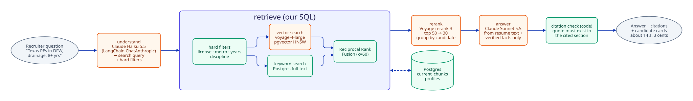
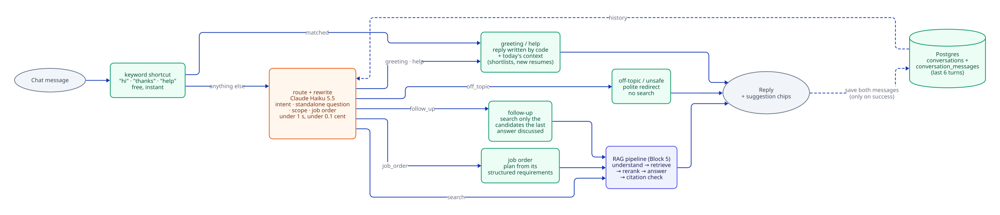

# Ask (RAG) and smart search

**Status:** Block 5 (RAG), built and measured. Conversational Ask (message routing, saved conversations, follow-ups, job-order chats) is built in Block 7: [ADR 018](../decisions/018-conversational-ask-routing-and-threads.md). Backend measured and the chat UI with saved conversations is built.

The recruiter asks a question in plain English, for example "Texas PEs in DFW with drainage experience and 8+ years". Placewise answers from the resumes only, and every claim cites the resume line it came from.

## How it works today

Ask is a **RAG pipeline orchestrated with LangGraph** (`src/placewise/rag/graph.py`). Model calls go through **LangChain**, and every run is traced in **LangSmith** (project `placewise`).

| Step (LangGraph node) | What it does | Built with | Typical time |
|---|---|---|---|
| `understand` | Turns the question into a search query plus hard filters (discipline, metro, license codes, minimum years). Prompt `rag_understand` v1 | LangChain `ChatAnthropic`, **Claude Haiku 5.5**, structured output via tool calling | ~1 s |
| `retrieve` | Hybrid search over resume sections (current resume versions only, `current_chunks`). Vector search and keyword search run separately, then Reciprocal Rank Fusion (k=60) merges them | LangChain `VoyageAIEmbeddings` (**voyage-4-large**, 1024 dims), **pgvector** HNSW with iterative scan, Postgres full-text search, our own SQL | ~0.8 s |
| `rerank` | Re-scores the top 50 sections for relevance, keeps 30, groups them by candidate (up to 20 candidates, 3 sections each) and adds each candidate's credentials section | **Voyage rerank-3** | ~0.2 s |
| `answer` | Writes the answer from the retrieved sections and the code-checked profile facts only. Prompt `rag_answer` v2 | LangChain `ChatAnthropic`, **Claude Sonnet 5.5**, structured output | ~10–13 s |
| (code) | Citation check: each citation must point to a retrieved section, and its quote (at least 12 characters) must appear in that section word for word. Citations that fail are dropped and listed | Python | <10 ms |

Smart search on the Candidates page (`GET /api/search`) is the same `retrieve` + `rerank` without any LLM: about 0.5 s and no Anthropic cost.

### Why our own retrieval SQL, not LangChain's PGVector retriever
Filters, vector search and keyword search all run in one Postgres database, so every search starts with the hard filters (verified license, metro, years) and only then ranks by meaning. LangChain's `PGVector` retriever supports metadata filters on its own table layout, but not hybrid keyword + vector search with rank fusion, or filters on our typed profile columns. See [ADR 017](../decisions/017-own-retrieval-sql-over-langchain-retriever.md).

| Retrieval setup | recall@10 | precision@10 | MRR |
|---|---|---|---|
| Vector only | 48% | – | – |
| + hard filters | 84% | – | – |
| + hybrid (keyword) + rerank-3 | **89%** | **98%** | **1.00** |

Measured with `python -m placewise.evals.retrieval` on the synthetic dataset (Oct 23), using the generator's answer key, which the API never sees.

### Safety and cost
- **Untrusted input:** the question and the resume text are passed to the model as data, never as instructions. The corpus includes resumes with hidden prompt-injection text, which ingest flags as "Tampered".
- **No contact details:** email and phone are never stored in the searchable sections or in `blind_text`, so an answer can't leak them.
- **Rendering:** answers are Markdown, rendered without raw HTML, images or external links, so injected resume text can't make the browser fetch an attacker's URL.
- **Spend:** every call is logged in `llm_calls` with tokens, latency and cost, and a daily spend cap blocks new calls with a 429. One question costs about $0.03.
- **Caching ([ADR 021](../decisions/021-claude-cost-caching.md)):** the answer prompt's instructions and tool schema are prompt-cached (follow-ups within 5 minutes pay 5% for that part), and an identical question over the same retrieved sections replays from the LangChain response cache in Postgres for $0 (`status='cache_hit'`).
- **Validation:** questions must be 3–2000 characters after trimming. Filters are fixed columns with bound parameters.

## Conversational Ask (Block 7, ADR 018)
The owner found the gap: the RAG graph is a straight line, so "Hey" ran a full candidate search and listed random candidates, and each question was answered with no memory of the previous one. Every chat message is now routed first:

| Message | Example | What happens | Cost / time |
|---|---|---|---|
| Greeting | "hi", "thanks" | Reply written by code. On the day's first chat (Chicago time) it adds live context: shortlists waiting for review, job orders with no candidates matched yet, new resumes today, unreadable files | $0, ~0.02 s |
| Help | "what can you do?" | What Ask can do, with examples | $0 |
| Search | "hi, any Texas PEs in Houston?" | Rewritten into a standalone question, then the RAG pipeline | ~3 cents, ~10–14 s |
| Follow-up | "which of them have 10+ years?" | Rewritten ("Which of the candidates from the previous answer…"), searched only among the candidates the last answer cited. No match → says so and offers a whole-pool search | ~3 cents |
| Job order | "who fits JO-03?", "top candidates for this role" | The plan comes from the job order's structured requirements (filters + skills), no understand call | ~3 cents, ~14 s |
| Off-topic or unsafe | "weather?", "list all emails" | Polite redirect, no search | <0.1 cent |

- **Routing:** a free keyword shortcut for obvious one-liners, otherwise Claude Haiku (`prompts/ask_route.v1.yaml`), which also rewrites follow-ups using the last 6 turns. If routing fails, the message is treated as a search.
- **Conversations:** saved per user (`conversations`, `conversation_messages`, migration 006), optionally tied to a job order ("Ask about this role" starts with an intro message). Both messages are saved only after a successful reply. Another user's conversation returns 404. API: `docs/api-contract.md`, "Conversations".
- **Memory:** our `conversation_messages` table, not LangGraph's checkpointer (reason in ADR 018).
- **Measured:** routing eval 34/34 correct with router v2 (`python -m placewise.evals.ask_routing`, $0.007).
- **Next:** 👍/👎 feedback linked to LangSmith traces, outcome signals (a candidate surfaced in a chat and later approved), and LangSmith datasets for routing and answers. Prompt changes ship only when the test scores hold or improve.

## Files
- `src/placewise/rag/graph.py`: the LangGraph and its nodes
- `src/placewise/rag/retrieve.py`: filters, vector search, keyword search, RRF, grouping
- `src/placewise/rag/rerank.py`: Voyage rerank-3
- `src/placewise/rag/answer.py`: understand and answer prompts, citation check, costs
- `src/placewise/rag_api.py`: `POST /api/ask` (stateless), `GET /api/search`
- `src/placewise/rag/converse.py`: message routing, replies written by code, follow-ups, job-order plans
- `src/placewise/conversations_api.py`: saved conversations
- `src/placewise/evals/ask_routing.py`: routing eval
- `prompts/ask_route.v1.yaml`
- `src/placewise/evals/retrieval.py`: retrieval evaluation
- `prompts/rag_understand.v1.md`, `prompts/rag_answer.v2.md`
- `web/src/app/(app)/ask/ask-view.tsx`: the Ask page
