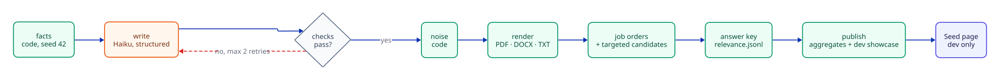

# Module: Synthetic data (Block 1)

## Purpose (plain words)
Placewise needs resumes and job orders to build and test against, and it must **never** use real people's data. Block 1 generates a realistic, fully fake A/E/C candidate pool (597 resumes as PDF, DOCX and TXT) plus 15 job orders, **and the correct answers for all of them**.

Because code decides every fact first and the LLM only writes the resume around those facts, we always know the truth: who holds a Texas PE, who is only "pursuing PE", who is a strong match for which job order. Later blocks use that answer key to measure extraction accuracy (Block 2) and match quality (Block 6), instead of eyeballing outputs.

For the owner there is a dev-only **Seed page** (`http://localhost:3000/seed`) that shows generation progress, aggregate stats, a few dev-split showcase resumes in an in-page viewer, and the job orders.

Code: `src/placewise/seed/` · API: `src/placewise/dev_seed.py` · Page: `web/src/app/seed/` · Prompts: [`prompts/`](../../prompts/)
Diagrams: [seed pipeline sequence](../diagrams/sequence-seed-pipeline.md) · [architecture](../diagrams/architecture.md)
Decisions: [ADR 006](../decisions/006-synthetic-data-code-facts-as-ground-truth.md) · [ADR 007](../decisions/007-structured-llm-output-plus-rendering.md) · [ADR 008](../decisions/008-answer-key-isolation.md) · [ADR 009](../decisions/009-haiku-writer-separate-from-reader.md)

## Data flow


*Synthetic data flow (code steps green, LLM step orange). Source: [`diagrams/src/synthetic-data-flow.d2`](../diagrams/src/synthetic-data-flow.d2).*

| Step | Command | Reads | Writes |
|---|---|---|---|
| 1. Facts | `facts` | — | `truth/candidates.jsonl` |
| 2. Write + check | `write` | `truth/candidates.jsonl`, `prompts/seed_resume_writer.v5.yaml` | `generated/resumes.jsonl` |
| 3–4. Noise + render | `render` | facts, `generated/resumes.jsonl` | `resumes/<id>/…`, `generated/files.jsonl` |
| 5–6. Job orders + answer key | `job-orders` | facts | targeted candidates appended to `truth/candidates.jsonl`; `truth/job_orders.jsonl`; `truth/relevance.jsonl`; `generated/job_orders.jsonl` (notes) |
| 7. Publish | runs at the end of `facts`, `render` and `job-orders` | truth + generated | `public/stats.json`, `showcase.json`, `files.json`, `job_orders.json` |

All paths are under `data/seed/` (see `seed/paths.py`). `job-orders` adds the targeted candidates to the facts, so the full order is `facts → write → render → job-orders → write → render` (the second `write` only writes the new targeted resumes).

### Folders
| Folder | Contents | Who can see it |
|---|---|---|
| `data/seed/truth/` | **Answer key:** candidate facts, job-order specs, relevance labels | `seed` container only |
| `data/seed/generated/` | Resume content (structured + final text), file index, job-order notes. No labels. | `seed` container |
| `data/seed/resumes/` | Rendered files, one folder per candidate (gitignored, rebuilt by `render`) | `seed` (rw), `api` (ro) |
| `data/seed/public/` | Progress, aggregate stats, file list, dev-split showcase (gitignored, rebuilt by publish) | `seed` (rw), `api` (ro) |
| `outputs/samples/` | One PDF per template for visual review | `seed` (rw), `api` (ro) |

## Facts model (the ground truth)
`seed/facts.py` builds each `CandidateFacts` with a fixed random seed (**42**) and a fixed "today" (**`AS_OF = 2026-10-22`**), so the same command always produces the same people.

- **Who:** fake name (Faker), `@example.com` email, `555-01xx` phone, city and metro (DFW ~60%, Houston, Austin, San Antonio, a few out of state), relocation flag.
- **Career:** discipline (architecture, interior design, civil, structural, MEP, construction management), specialty, years of experience, 1–5 employers split into stints. Titles follow the career level at each point (`_split_promotions`), so people get promoted within an employer instead of jumping titles.
- **Credentials** with realistic base rates by discipline and seniority: PE, EIT, RA, SE, NCARB, NCIDQ, Texas RID, LEED AP/GA, PMP, CCM, OSHA 30. Each has a `status` (`active`, `expired`, `pursuing`, `exam_scheduled`) and `counts` (held or not).
- `license_codes` (e.g. `PE:TX`, `LEED_AP`) lists only credentials actually held; the answer key uses it.
- **Style** (template, persona, length, file format, heading style, date style), chosen by code.
- **Tricky cases** (~15% of base people): out-of-state PE, expired license, pursuing PE, LEED GA instead of AP, career gap, short/long resume, unusual headings, two-column layout, typos. Plus prompt-injection PDFs, image-only PDFs, corrupt DOCX, exact duplicates, format duplicates (same person, different file) and "updated" resumes (same person with a newer job). About 8% are deliberately poorly written (`messy` persona).
- `recompute_years` sets years of experience from the dated jobs (gaps excluded, overlaps merged), so the answer key matches what the resume shows.
- **Split by person** (`split_for`, a hash of seed + person id): about 30% dev / 70% test. Duplicates of one person always land in the same split.

### Credential phrasing is chosen by code
The same license is written many ways on real resumes. Code picks the exact phrase and stores it in `Credential.text`, for example:

| Credential | Phrases code can pick |
|---|---|
| PE | `P.E., Texas #123456` · `Professional Engineer (TX), License No. 123456` · `Licensed PE - Texas` · `PE (TX #123456)` · `Registered Professional Engineer, State of Texas` |
| Pursuing PE | `Preparing for the PE exam` · `Working toward PE licensure` · `PE exam scheduled for Mar 2027` |
| LEED | `LEED AP BD+C` · `LEED Accredited Professional (BD+C)` · `LEED AP ID+C` (interior designers) · `LEED Green Associate` · `LEED GA` |
| Expired | any phrase + ` (inactive)` |

The writer must copy the phrase exactly. **Why:** the messiness in the facts that matter most comes from code, not from the style of the model that will later read the resumes.

## Writer and checks
`seed/writer.py`, prompt [`seed_resume_writer.v5.yaml`](../../prompts/seed_resume_writer.v5.yaml).

1. `facts_for_writer` passes only what a resume would contain. Labels such as split, tricky flags and `license_codes` are never sent (a test checks this).
2. **Claude Haiku 5.5** via LangChain `ChatAnthropic(...).with_structured_output(StructuredResume, include_raw=True)` returns a Pydantic `StructuredResume` (name, contact, headline, summary, jobs with bullets, skills, credentials, education, optional extra sections). Persona, length and heading-style hints come from the prompt file. No `temperature` (Claude 5.5 models reject it).
3. **Structural check** (`structural_check`): exact name; same number of jobs in the same order; each job's title, employer, start and end exactly match the facts; 2–6 bullets per job (the prompt asks for 2–5; 6 is tolerated); no known A/E/C software that isn't in the facts ("Revit" is allowed when the facts say "Revit MEP"); no relocation claim unless the person is open to it; exact education; the credentials list equals the facts' phrases.
4. **Text fact check** (`factcheck.check`) on the plain text:
   - *Missing:* every must-include string (name, credential phrases, employers, titles, dates, schools) appears.
   - *Invented:* after removing allowed phrases and job titles, no credential family appears that the person doesn't **hold**. A "pursuing PE" candidate can't be called a PE anywhere else.
   - *Exact level and state:* LEED GA holders can't be called LEED AP; a PE or RA can't be tied to a state they aren't licensed in.
   - No commentary or code fences.
5. If any check fails, the problems are added to the prompt and the writer tries again, **up to 2 retries**. Permanent 4xx errors (except 429) stop at once; 429 and 5xx are retried with backoff.
6. Each accepted row stores `prompt_version` and a `facts_hash` (fingerprint of what the writer saw). `write` redoes any resume that is missing, from an older prompt version, or whose facts changed.

Result: **597 of 597 resumes pass both checks.** Exact and format duplicates reuse the source person's content instead of a new LLM call.

Prompt history (v1–v4 are kept for reference; each file's changelog explains why it changed):

| Version | Change | Why |
|---|---|---|
| v1 | Free-text resume | Initial |
| v2 | Omit empty sections | v1 wrote "Licenses & Certifications: None listed." |
| v3 | Style hints moved into YAML; no layout labels | The model printed "SIDEBAR" as literal text |
| v4 | Structured output (`StructuredResume`) | Owner review: v3 resumes looked poor and layouts broke on heading-guessing |
| v5 | Adds the `messy` persona | Poorly written resumes are intentional and labeled |

## Noise (added by code)
`seed/noise.py` runs after the writer, on the structured resume:
- **Bullet symbol** varies per candidate (•, –, ▪, ◦, -).
- **Typos** (2–5 swapped letters in the summary and bullets) **only** where the answer key has the `typos` flag, so typo-detection evals have no false positives on "polished" resumes.
- Protected words (names, titles, employers, dates, schools, credential phrases, sectors) are never changed, so the answer key stays correct.
- Randomness is seeded from the candidate id, so re-renders are identical.

## Templates and files
`seed/render.py` renders the structured resume (never parsing layout back out of free text, see [ADR 007](../decisions/007-structured-llm-output-plus-rendering.md)).

| Template | Look |
|---|---|
| `classic` | Serif, centered header |
| `modern` | Sans-serif with accent color |
| `two_column` | Sidebar with contact, skills, credentials, education (PDF text may interleave columns) |
| `compact` | Dense single column |
| `ats_plain` | Very plain, ATS-style |

- **Formats:** PDF (ReportLab), DOCX (python-docx), TXT. DOCX and TXT also get a `_preview.pdf`, so the Seed page can show every readable resume in the browser.
- **Deterministic PDFs** (`invariant=1`: no timestamp or random document id), so the same resume always renders to the same bytes. Ingest idempotency (Block 2) will hash files.
- **Hard cases:** hidden prompt-injection text (white, 1pt) in 5 PDFs; 4 image-only "scanned" PDFs with no text layer; 4 truncated, corrupt DOCX files (no preview, by design); 8 byte-for-byte exact copies.
- File names vary (`Jane_Doe_Resume.pdf`, `CV_JANE_DOE.docx`, …). PDF metadata marks every file as synthetic.
- `render --ids …` merges into the existing file index (atomic replace) instead of overwriting it.

**Final files:** 597 (349 PDF, 190 DOCX, 58 TXT).

## Quality labels
Every candidate gets a `quality` label in the answer key (`label_quality`), so later blocks can check whether ingest detects problems on its own:

| Label | Meaning | Count |
|---|---|---|
| `polished` | Normal, well-formed resume | 519 |
| `flawed` | Deliberate issues: typos, poorly written, short, unusual headings, career gap (`quality_issues` lists which) | 65 |
| `unusable` | Image-only PDF or corrupt DOCX | 8 |
| `adversarial` | Hidden prompt-injection text | 5 |

## Job orders and answer key
`seed/job_orders.py`.

- **15 hand-designed specs** (`JO-01` … `JO-15`) across civil, structural, MEP, architecture, interiors and construction. Clients are described generically ("Structural engineering firm (Dallas)"), never by real name.
- Each requirement has a kind (discipline, subdiscipline, license, cert, years, metro, software_any, sector_any) and a `critical` flag. Non-critical requirements are "preferred".
- Some specs leave out work mode, salary or employment type in the notes (`omit_in_notes`), so Block 4 has something to ask clarifying questions about.
- **Targeted candidates (97):** for each job order, 4 strong fits plus up to 3 near misses where one critical requirement fails (license in the wrong state, wrong metro, or 1.5–2.5 years short). 56 strong + 41 near misses. They are written, checked and rendered like everyone else. Every targeted candidate's intended grade matched its computed grade.
- **Recruiter notes** via prompt [`seed_job_order_notes.v1.yaml`](../../prompts/seed_job_order_notes.v1.yaml): Haiku turns the spec into messy call notes. The code marks each item as *required*, *preferred (not a deal-breaker)* or *nice to have*, so the notes agree with how the answer key grades.
- **Answer key** (`truth/relevance.jsonl`): every (job order, candidate) pair is graded from the **facts**, never from the resume text:
  - `strong`: every requirement met.
  - `partial`: exactly one non-critical miss, or the only miss is years and within 1 year.
  - `none`: anything else.
  Each row lists every requirement with `met` and a reason (e.g. `holds ['PE:OK']`). Only strong and partial rows, plus every targeted candidate's row, are stored; a missing pair means `none`.
- Every job order except **JO-15** has at least 5 strong matches. **JO-15** (Principal Structural, needs an Illinois SE **and** a Texas PE, 20+ years, stadium work, Tekla) has **0 by design**, to test that the matcher can say "no good match".

## Isolation
The answer key must never reach the app that is being evaluated ([ADR 008](../decisions/008-answer-key-isolation.md)).

| Container | `truth/` | `generated/` | `resumes/` | `public/` | `outputs/samples/` |
|---|---|---|---|---|---|
| `seed` (profile `tools`, on demand) | rw (mounts all of `./data`) | rw | rw | rw | rw |
| `api` | **not mounted** | not mounted | ro | ro | ro |

- `publish` writes only aggregate counts, the file list (notes such as "hidden injection text" only for dev-split files), the job-order notes (specs only for dev-split job orders) and full details for up to 12 **dev-split** showcase PDFs. Nothing per-candidate from the test split.
- `/api/dev/seed/*` is registered **only when `APP_ENV=dev`**; in prod those routes don't exist. Candidate ids are validated (`C` + digits) and paths are checked against traversal.
- The seed container sets `LANGSMITH_TRACING=false`: test-data generation is not product traffic.
- The truth files are committed to git (they are small and reproducible); isolation is about what the running app can read, not about hiding them from the owner.

## Anti-bias design and the honest caveat
If one model writes the resumes and the same kind of model reads them, extraction looks easier than it is on human resumes. Block 1 reduces that bias:
1. **Different writer and reader:** Haiku 5.5 writes; Sonnet 5.5 is planned to read in Block 2 ([ADR 009](../decisions/009-haiku-writer-separate-from-reader.md)).
2. **Code-injected messiness:** credential phrasing, date formats, typos, bullet symbols, layouts, unreadable and adversarial files all come from code.
3. **Answer key from facts, not text:** labels are computed from `CandidateFacts`, and the fact checks guarantee the text agrees.
4. **Dev/test split by person:** prompts and thresholds may be tuned on dev only; test is for reporting.
5. **Truth never mounted into the api.**

**Caveat:** synthetic resumes are still cleaner and more consistent than real ones (one writer, five templates, known vocabulary). Accuracy measured on this data is an **optimistic upper bound**, not a promise about real resumes.

## How to run
All commands run in the on-demand `seed` container (needs `PLACEWISE_ANTHROPIC_TEST_API_KEY` in `.env` for `write`, `samples` and `job-orders`).

```bash
docker compose run --rm seed facts --count 500 --seed 42     # facts only, no LLM, free
docker compose run --rm seed samples                         # one PDF per template → outputs/samples/
docker compose run --rm seed write --limit 10                # try a few first
docker compose run --rm seed write --concurrency 8           # all missing/stale resumes
docker compose run --rm seed render                          # noise + PDF/DOCX/TXT + publish
docker compose run --rm seed job-orders                      # targeted candidates, notes, answer key
docker compose run --rm seed write && docker compose run --rm seed render   # write/render the targeted ones
```

| Command | Options |
|---|---|
| `facts` | `--count` (default 500), `--seed` (default 42) |
| `write` | `--limit N`, `--ids C0001,C0002`, `--concurrency` (default 8), `--force` |
| `render` | `--ids …` (partial render merges into the index) |
| `samples` | — |
| `job-orders` | `--seed` (default 42), `--force` (rewrite notes) |
| `backfill-hash` | one-time: add `facts_hash` to old rows |

Then open **http://localhost:3000/seed** (dev only). The page polls `/api/dev/seed/status` for live progress during `write`.

## Costs
Haiku 5.5 at $0.10 input / $0.50 output per million tokens (price constants in `writer.py`).

| Run | Cost |
|---|---|
| Full resume rewrite (prompt v5) | about $0.64 |
| 97 targeted resumes | about $0.12 |
| Template samples and job-order notes | a few cents |

`write` prints tokens and estimated cost; `progress.json` shows the running cost on the Seed page.

## Tests
**103 Block 1 tests** (126 in total with Block 0's 23), all passing (QA verdict: PASS). They use small in-memory or temp-dir data and mock the LLM, so they cost nothing.

```bash
docker compose run --rm -T -v "$PWD/tests:/app/tests" --entrypoint pytest seed -q -p no:cacheprovider /app/tests
```
(`docker compose exec api uv run pytest` doesn't work: the api image's `/opt/venv` isn't writable and the tests aren't mounted there.)

| File | Covers |
|---|---|
| `test_seed_facts.py` | Determinism by seed, unique ids, job ordering/overlaps, date text matches style, updated and duplicate variants, `license_codes` exclude pursuing/expired, split by person, unreadable/injection formats |
| `test_seed_checks.py` | Fact check (missing, invented, pursuing-PE, dash/whitespace tolerance), structural check (titles, dates, job count, credentials, software, relocation, education, bullets), nested-list flattening, retry loop (feedback, max retries, schema failure, 4xx stop, 429 retry), no answer-key leak to the writer, prompt loading |
| `test_seed_render.py` | Every template renders PDF and valid DOCX, image-only PDF, injection text only when flagged, corrupt DOCX has no preview, DOCX/TXT previews, re-render replaces files, markup escaping, deterministic file names |
| `test_seed_job_orders.py` | strong / partial / none rules, wrong-state PE, pursuing/expired PE don't count, relocation satisfies metro, years near miss, alternative licenses, targeted candidates get their intended grade, JO-15 has no strong match |
| `test_seed_cli.py` | `facts` and `render` in a temp dir, exact-duplicate previews, empty facts file, rows without facts are skipped |
| `test_seed_dev_api.py` | View/download PDF, DOCX, TXT; corrupt DOCX → 409; missing → 404; bad ids and path traversal rejected; routes exist only in dev |

## Failure modes
| Failure | Handling |
|---|---|
| Writer invents a credential, tool or state | Fact checks reject it; retry with the problems listed; rejected after 2 retries (rerun `write` to retry only rejects) |
| Output doesn't match the schema | Retried with the parsing error; nested lists in extra sections are flattened instead of rejected |
| Permanent API error (4xx) | Stops at once, no wasted retries; 429 and 5xx retried with backoff |
| Facts or prompt changed after writing | `facts_hash` / `prompt_version` mismatch → `write` redoes those resumes |
| Crash mid-run | Progress saved every 25 resumes; all JSONL/JSON writes are atomic (temp file + rename) |
| Partial render | Merges into `files.jsonl`, other entries kept |
| Seed page reads a file mid-replace | Returns the default; the next poll succeeds |

## Known limits
- Synthetic accuracy is an optimistic upper bound (see the caveat above).
- Five templates and one writer model: less variety than real resumes. **Resume Generator v2** (stronger writer, more templates and formatting quirks, visual QA, a "show hidden text" view) is deferred to [PLAN item 11](../PLAN.md).
- Candidate ids reveal generation order (targeted candidates are `C0501`+). Harmless while ingest never sees ids; ingest must assign its own.
- `CRED_PATTERNS` in the fact check are conservative: they catch the common spellings, not every possible phrasing.
- Employer names are real A/E/C firms, used only for realism; every person, role and project is fictional and every file is marked synthetic.
- The Seed page is a dev tool; it becomes an admin page in Block 3.
